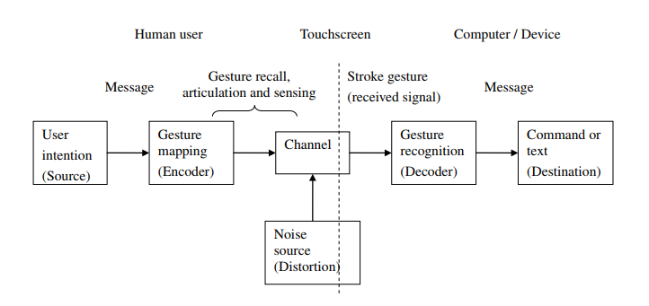
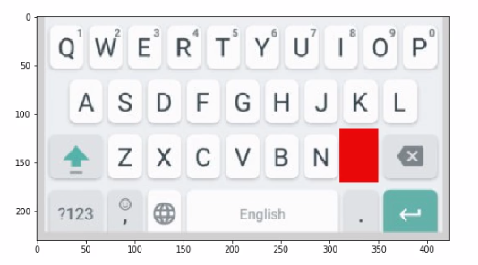
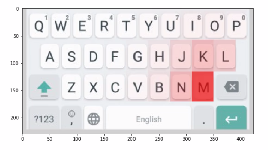
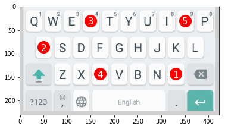
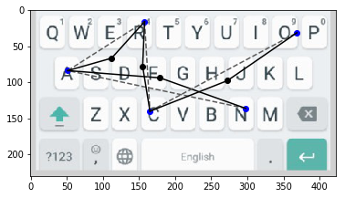
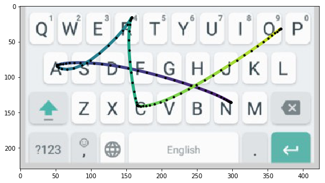
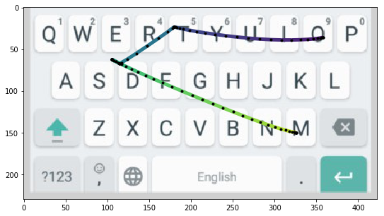
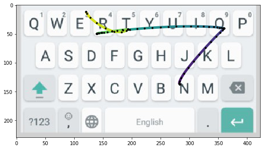
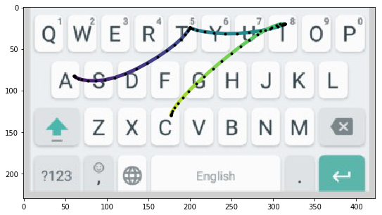
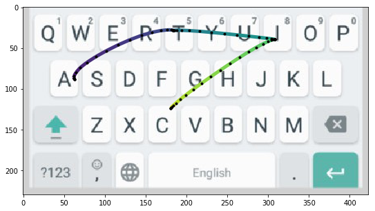

# LSTM Networks with CTC Loss Applied to Gesture Typing Decoding

*Redes LSTM com custo CTC aplicadas à decodificação de digitação por gestos*

**📖 [Read the thesis online (English)](thesis.md)**, or use the PDFs below.

Undergraduate thesis (B.Sc. in Software Engineering), Institute of Computing, Federal University of Amazonas (UFAM), Brazil. Approved on June 21, 2018.

- **Author:** Willians Cassiano de Freitas Abreu
- **Advisor:** Prof. Marco Antônio Pinheiro de Cristo
- **Co-advisor:** Prof. Juan Gabriel Colonna
- **Examiner:** Prof. Eulanda Miranda dos Santos

## Files

| | Portuguese (original) | English (translation) |
|---|---|---|
| Thesis text | [Undergraduate Thesis Text (Portuguese).pdf](Undergraduate%20Thesis%20Text%20(Portuguese).pdf) | [Undergraduate Thesis Text (English).pdf](Undergraduate%20Thesis%20Text%20(English).pdf) |
| Defense slides | [Undergraduate Thesis Defense (Portuguese).pdf](Undergraduate%20Thesis%20Defense%20(Portuguese).pdf) | [Undergraduate Thesis Defense (English).pdf](Undergraduate%20Thesis%20Defense%20(English).pdf) |

The work was originally written and defended in Portuguese. The English versions are faithful translations of the text and slides; the figures are the originals.

## Summary

Gesture typing (the "swipe" keyboard) lets a user enter a whole word with one stroke across a touchscreen keyboard. Decoding that stroke is much harder than detecting key taps. The same trace can match several words ("Brasil" and "nescio" look almost the same on QWERTY), users rarely pass exactly over every key, and people swipe in different styles.

*Gesture typing seen as a noisy channel: the user encodes a word as a stroke, motor and cognitive noise distort it, and the decoder must recover the most likely word.*

This work implements a neural gesture decoder based on Alsharif et al. (Google, 2015), plus the synthetic data pipeline needed to train it:

- **Decoder.** A bidirectional LSTM (512 units, about 2.2M parameters) trained with **Connectionist Temporal Classification (CTC)** loss. CTC maps an unsegmented sequence of touch points to a sequence of characters without needing an alignment between the two.
- **Lexicon-constrained decoding.** The per-timestep character probabilities from the LSTM weight the edges of a finite-state transducer built as a **Trie** over the vocabulary. **Beam search** (k = 3) over the Trie then returns only valid words.

  

  *End-to-end decoding: the Bi-LSTM turns the gesture G into per-timestep character probabilities y, and beam search over the vocabulary Trie turns them into a ranked list of words.*
- **Probabilistic feature extractor (new).** Alsharif et al. feed the network a one-hot vector for the key under the finger. This work instead feeds the probability of *each* key being the intended one, a function of the distance to each key's center. That encodes the uncertainty when the finger is between keys.

  
 

  *Input for the same touch point: the one-hot key used by Alsharif et al. (left) vs. this work's per-key probabilities with δ = 0.025, the value used in the experiments (right).*
- **Gesture synthesis.** No real swipe data was available, so gestures are generated from words following Quinn & Zhai (2018):
  - key targets are sampled with Gaussian noise;
  - via-points are perturbed to add realistic curvature;
  - the points are joined with **minimum-jerk trajectories**, a model of smooth human movement.

  
  

  *Synthesizing a gesture for `MARCO`, left to right: the key targets in order, the noisy targets interleaved with rotated via-points, and the final minimum-jerk trajectory (purple at the start, yellow at the end).*

## Results

The model was trained on about 150k synthetic gestures over a lexicon of about 63k English words. It was tested on 12k gestures for words never seen in training.

| Decoding | Accuracy |
|---|---|
| LSTM output only (argmax) | 65.51% |
| LSTM + Trie beam search | **96.95%** |
| LSTM + Trie, correct word in the top 3 | 97.76% |

- **Reference model:** the baseline (Alsharif et al.) reports 93.5% on its own dataset. The setups differ, so this is not a head-to-head comparison.
- **Transfer to Portuguese:** swapping in a Portuguese lexicon, with no retraining, reached **99.4%** accuracy on the 1,000 most common Portuguese words (unaccented).

  
 

  *Correctly decoded Portuguese words `ORDEM` and `NORTE`, recognized by the English-trained network with only the lexicon swapped.*

- **Error analysis:** many remaining errors come from outlier synthetic gestures. Re-testing the failed words with new synthetic gestures recovered 43% of them.

  
 

  *Two synthetic gestures for `ATTIC`: the left one is decoded correctly, the right one is read as `SATIN`. Small variations from the synthesizer are enough to flip the prediction.*

**Keywords:** gesture typing, LSTM, connectionist temporal classification, beam search, gesture synthesis, minimum-jerk trajectories.
